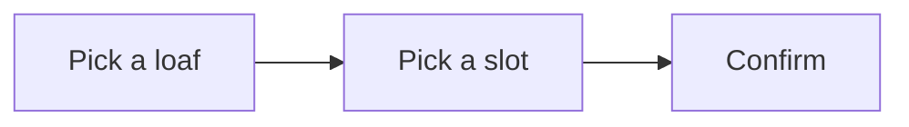

# User Stories — Bakery Pre-order

Written from `requirements.md`. Each story is one visible behaviour; criteria are Given/When/Then.

## US1 — Reserving loaves

### US1.1 Reserve a loaf for tomorrow
As a customer, I want to reserve a loaf before 18:00, so that it is waiting for me in the morning.
Priority: Must · Depends on: —
- AC1.1.1 Given the shop is open for orders, when I pick a loaf and a pick-up slot, then the reservation is saved and I see a confirmation.
- AC1.1.2 Given it is after 18:00, when I open the order page, then I see that orders for tomorrow are closed.

| Story | Persona | Priority |
|---|---|---|
| US1.1 | Customer | Must |
| US1.2 | Baker | Should |

